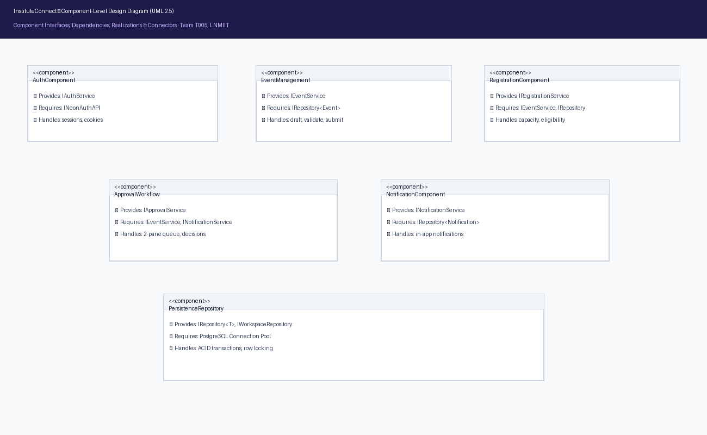

# Component-Level Design Specification (Assignment 06 & 07)
**System:** InstituteConnect – Academic Outreach & Event Collaboration Portal  
**Document Version:** 1.0.0  
**Status:** Approved / Implemented  
**Date:** November 2026  

---

## 1. Overview & Component Architecture

Component-level design translates the architectural and domain class models into concrete procedural algorithms, contracts, and component interfaces. Each service is fully decoupled, state-isolated, and adheres to the **Single Responsibility Principle (SRP)**.

### 1.1 Architectural Component Hierarchy



The core domain services interact with repositories and infrastructure components through defined contracts:
1. `EventService`: Manages event lifecycle, scheduling validation, and state progression.
2. `RegistrationService`: Manages participant registrations, concurrency locks, capacity quotas, and cancellations.
3. `ApprovalService`: Governs two-stage administrative workflows, sanction checks, and reviewer feedback.
4. `NotificationService`: Handles multi-channel event notifications (Email, In-App Alert, SMS).
5. `Repository<T>`: Generic, type-safe data access layer abstracting storage mechanisms.

---

## 2. Core Service Component Specifications & Algorithms

---

### 2.1 Component: `EventService`

#### 2.1.1 Contract Specification
- **Interface:** `IEventService`
- **Responsibilities:** Validates event metadata, coordinates schedule conflict detection, initializes event records, and handles draft vs approval submissions.
- **Dependencies:** `Repository<Event>`, `NotificationService`, `ApprovalService`

#### 2.1.2 Method: `createEvent(details, coordinatorId, action)`
- **Preconditions:**
  - `coordinatorId` represents an authenticated user with coordinator or administrator privileges.
  - `details` contains event payload including `title`, `dates`, `category`, and `capacity`.
  - `action` is either `'draft'` or `'submit'`.
- **Postconditions:**
  - If `action == 'draft'`, an `Event` instance is created or updated with status `DRAFT`.
  - If `action == 'submit'`, all business validations pass, and event status becomes `PENDING_APPROVAL`.
  - Notifications are dispatched to designated approvers if submitted.
- **Exceptions:**
  - `ValidationException` (HTTP 400): Thrown if dates are inverted, title is missing, capacity is invalid, or time conflicts arise.
  - `UnauthorizedException` (HTTP 403): Thrown if user lacks event creation privileges.

#### 2.1.3 Pseudocode / Algorithm
```text
ALGORITHM createEvent(details, coordinatorId, action):
    INPUT: details (Object), coordinatorId (String), action (String)
    OUTPUT: ValidationResult (success, event, errors)

    1. Initialize errors list = []
    
    2. IF action == 'draft' THEN:
         // Relaxed validation for draft state
         IF details.title is NULL or TRIM(details.title) == "" THEN
             APPEND "Title is required even for draft events" TO errors
         END IF
         
         IF errors is NOT EMPTY THEN
             RETURN ValidationResult(isValid: FALSE, errors: errors)
         END IF
         
         event = NEW Event(
             id: GenerateUniqueId("EVT"),
             title: details.title,
             category: details.category DEFAULT "GENERAL",
             mode: details.mode DEFAULT "OFFLINE",
             status: EventStatus.DRAFT,
             coordinatorId: coordinatorId,
             dates: details.dates,
             venue: details.venue,
             capacity: details.capacity DEFAULT 0,
             createdAt: CurrentTimestamp()
         )
         EventRepository.save(event)
         RETURN ValidationResult(isValid: TRUE, data: event)
       END IF

    3. // Rigorous validation for 'submit' action
    4. IF details.title is NULL OR LENGTH(TRIM(details.title)) < 5 THEN
           APPEND "Event title must be at least 5 characters long." TO errors
       END IF
       
    5. IF details.startDate is NULL OR details.endDate is NULL THEN
           APPEND "Start date and end date are required." TO errors
       ELSE IF details.startDate < CurrentDate() THEN
           APPEND "Start date cannot be in the past." TO errors
       ELSE IF details.endDate < details.startDate THEN
           APPEND "End date cannot be earlier than start date." TO errors
       END IF

    6. IF details.startTime >= details.endTime AND details.startDate == details.endDate THEN
           APPEND "End time must be after start time on the same date." TO errors
       END IF

    7. IF details.capacity is NULL OR ParseInteger(details.capacity) <= 0 THEN
           APPEND "Capacity must be a positive integer greater than zero." TO errors
       END IF

    8. IF details.targetInstitutions is EMPTY THEN
           APPEND "At least one target institution category must be specified." TO errors
       END IF

    9. IF errors is NOT EMPTY THEN
           RETURN ValidationResult(isValid: FALSE, errors: errors)
       END IF

    10. // Conflict Detection Check
    11. conflictingEvents = EventRepository.findConflicting(details.venue, details.dates, details.times)
    12. IF conflictingEvents is NOT EMPTY THEN
            APPEND "Venue is already booked for another event during this timeslot." TO errors
            RETURN ValidationResult(isValid: FALSE, errors: errors)
        END IF

    13. event = NEW Event(
            id: GenerateUniqueId("EVT"),
            title: details.title,
            category: details.category,
            mode: details.mode,
            status: EventStatus.PENDING_APPROVAL,
            coordinatorId: coordinatorId,
            schedule: details.schedule,
            venue: details.venue,
            capacity: ParseInteger(details.capacity),
            targetInstitutions: details.targetInstitutions,
            createdAt: CurrentTimestamp(),
            updatedAt: CurrentTimestamp()
        )

    14. EventRepository.save(event)

    15. // Trigger Approver Notifications
    16. approvers = UserRepository.findUsersByRole(UserRole.DEAN_OUTREACH, UserRole.HOD)
    17. FOR EACH approver IN approvers DO
            NotificationService.createNotification(
                approver.id,
                "New event proposal '" + event.title + "' submitted for your review.",
                NotificationType.APPROVAL_REQUEST
            )
        END FOR

    18. RETURN ValidationResult(isValid: TRUE, data: event)
END ALGORITHM
```

---

### 2.2 Component: `RegistrationService`

#### 2.2.1 Contract Specification
- **Interface:** `IRegistrationService`
- **Responsibilities:** Manages participant seat reservations, validates eligibility and deadlines, maintains waitlists, and dispatches registration tickets.
- **Dependencies:** `Repository<Registration>`, `Repository<Event>`, `NotificationService`

#### 2.2.2 Method: `register(userId, eventId)`
- **Preconditions:**
  - `userId` is a valid registered user.
  - `eventId` corresponds to an active published event (`EventStatus.APPROVED` or `PUBLISHED`).
- **Postconditions:**
  - A new `Registration` record is saved with status `CONFIRMED` or `WAITLISTED`.
  - The event's current registration count is incremented atomically.
  - A confirmation notification with ticket token is sent to the participant.
- **Exceptions:**
  - `RegistrationClosedException`: Event deadline has passed or event is canceled.
  - `DuplicateRegistrationException`: User is already registered for this event.

#### 2.2.3 Pseudocode / Algorithm
```text
ALGORITHM register(userId, eventId):
    INPUT: userId (String), eventId (String)
    OUTPUT: RegistrationResult (success, registration, message)

    1. event = EventRepository.findById(eventId)
    2. IF event is NULL THEN
           THROW NotFoundException("Event not found with ID: " + eventId)
       END IF

    3. // Status & Deadline Check
    4. IF event.status != EventStatus.APPROVED AND event.status != EventStatus.PUBLISHED THEN
           RETURN RegistrationResult(success: FALSE, message: "Registration is not open for this event.")
       END IF

    5. IF CurrentTimestamp() > event.registrationDeadline THEN
           RETURN RegistrationResult(success: FALSE, message: "Registration closed. Deadline has passed.")
       END IF

    6. // Check Duplicate Registration
    7. existing = RegistrationRepository.findByUserAndEvent(userId, eventId)
    8. IF existing is NOT NULL AND existing.status != RegistrationStatus.CANCELLED THEN
           RETURN RegistrationResult(success: FALSE, message: "User is already registered for this event.")
       END IF

    9. // Eligibility Criteria Verification
    10. user = UserRepository.findById(userId)
    11. IF NOT event.isUserEligible(user) THEN
            RETURN RegistrationResult(success: FALSE, message: "User does not meet institution eligibility criteria.")
        END IF

    12. // Capacity & Concurrency Control
    13. ACQUIRE LOCK (event.id)
    14. TRY
            currentRegistrations = RegistrationRepository.countConfirmed(eventId)
            IF currentRegistrations < event.capacity THEN
                registrationStatus = RegistrationStatus.CONFIRMED
                waitlistPosition = NULL
            ELSE
                registrationStatus = RegistrationStatus.WAITLISTED
                waitlistPosition = RegistrationRepository.countWaitlist(eventId) + 1
            END IF

            registration = NEW Registration(
                id: GenerateUniqueId("REG"),
                eventId: eventId,
                userId: userId,
                status: registrationStatus,
                registeredAt: CurrentTimestamp(),
                ticketCode: GenerateTicketCode(eventId, userId),
                waitlistPosition: waitlistPosition
            )
            RegistrationRepository.save(registration)

            // Update cached event count
            IF registrationStatus == RegistrationStatus.CONFIRMED THEN
                event.registeredCount = event.registeredCount + 1
                EventRepository.save(event)
            END IF
        FINALLY
            RELEASE LOCK (event.id)
        END TRY

    15. // Send Confirmation Notification
    16. IF registrationStatus == RegistrationStatus.CONFIRMED THEN
            NotificationService.createNotification(
                userId,
                "Registration confirmed for " + event.title + ". Ticket: " + registration.ticketCode,
                NotificationType.REGISTRATION_CONFIRMED
            )
        ELSE
            NotificationService.createNotification(
                userId,
                "Event at full capacity. You are placed at waitlist position #" + waitlistPosition,
                NotificationType.WAITLIST_ALERT
            )
        END IF

    17. RETURN RegistrationResult(success: TRUE, registration: registration)
END ALGORITHM
```

---

### 2.3 Component: `ApprovalService`

#### 2.3.1 Contract Specification
- **Interface:** `IApprovalService`
- **Responsibilities:** Enforces administrative review protocols, audits decisions, prevents self-approvals, and updates event visibility.
- **Dependencies:** `Repository<ApprovalReview>`, `Repository<Event>`, `NotificationService`

#### 2.3.2 Method: `approve(eventId, approverId, comments)`
- **Preconditions:**
  - `approverId` has `ADMIN` or `APPROVER` authority.
  - `eventId` exists and is currently in `PENDING_APPROVAL` status.
- **Postconditions:**
  - Event status is updated to `APPROVED` / `PUBLISHED`.
  - An `ApprovalReview` record with decision `APPROVED` is logged with timestamp and remarks.
  - Notification dispatched to the event coordinator.

#### 2.3.3 Pseudocode: `approve`
```text
ALGORITHM approve(eventId, approverId, comments):
    INPUT: eventId (String), approverId (String), comments (String)
    OUTPUT: Boolean

    1. event = EventRepository.findById(eventId)
    2. IF event is NULL THEN
           THROW NotFoundException("Event not found.")
       END IF

    3. IF event.status != EventStatus.PENDING_APPROVAL THEN
           THROW InvalidOperationException("Event is not currently awaiting approval.")
       END IF

    4. approver = UserRepository.findById(approverId)
    5. IF approver.role NOT IN [UserRole.HOD, UserRole.DEAN_OUTREACH, UserRole.ADMIN] THEN
           THROW UnauthorizedException("User lacks authorization to approve event proposals.")
       END IF

    6. IF event.coordinatorId == approverId THEN
           THROW PolicyViolationException("Coordinators cannot approve their own event proposals.")
       END IF

    7. // Create Audit Record
    8. review = NEW ApprovalReview(
           id: GenerateUniqueId("REV"),
           eventId: eventId,
           approverId: approverId,
           decision: ApprovalDecision.APPROVED,
           comments: comments DEFAULT "Approved as proposed.",
           reviewedAt: CurrentTimestamp()
       )
    9. ApprovalReviewRepository.save(review)

    10. // Transition Event Lifecycle State
    11. event.status = EventStatus.APPROVED
    12. event.approvedBy = approverId
    13. event.approvedAt = CurrentTimestamp()
    14. EventRepository.save(event)

    15. // Notify Submitting Coordinator
    16. NotificationService.createNotification(
            event.coordinatorId,
            "Your proposal for '" + event.title + "' has been approved by " + approver.name,
            NotificationType.PROPOSAL_APPROVED
        )

    17. RETURN TRUE
END ALGORITHM
```

#### 2.3.4 Method: `reject(eventId, approverId, reason)`
- **Preconditions:**
  - `reason` must be non-empty (mandatory justification for rejection).
- **Postconditions:**
  - Event status transitions to `REJECTED`.
  - Audit trail records reason for future re-submission.
  - Coordinator notified with review feedback.

#### 2.3.5 Pseudocode: `reject`
```text
ALGORITHM reject(eventId, approverId, reason):
    INPUT: eventId (String), approverId (String), reason (String)
    OUTPUT: Boolean

    1. IF reason is NULL OR TRIM(reason) == "" THEN
           THROW ValidationException("Rejection reason is mandatory.")
       END IF

    2. event = EventRepository.findById(eventId)
    3. IF event is NULL OR event.status != EventStatus.PENDING_APPROVAL THEN
           THROW InvalidOperationException("Invalid event or event not in review status.")
       END IF

    4. review = NEW ApprovalReview(
           id: GenerateUniqueId("REV"),
           eventId: eventId,
           approverId: approverId,
           decision: ApprovalDecision.REJECTED,
           comments: reason,
           reviewedAt: CurrentTimestamp()
       )
    5. ApprovalReviewRepository.save(review)

    6. event.status = EventStatus.REJECTED
    7. event.rejectionReason = reason
    8. event.updatedAt = CurrentTimestamp()
    9. EventRepository.save(event)

    10. NotificationService.createNotification(
            event.coordinatorId,
            "Your proposal for '" + event.title + "' was rejected. Reason: " + reason,
            NotificationType.PROPOSAL_REJECTED
        )

    11. RETURN TRUE
END ALGORITHM
```

---

### 2.4 Component: `NotificationService`

#### 2.4.1 Contract Specification
- **Interface:** `INotificationService`
- **Responsibilities:** Constructs multi-channel notification payloads, dispatches asynchronous alerts, and logs delivery receipts.

#### 2.4.2 Pseudocode: `createNotification(userId, message, type)`
```text
ALGORITHM createNotification(userId, message, type):
    INPUT: userId (String), message (String), type (NotificationType)
    OUTPUT: Notification

    1. user = UserRepository.findById(userId)
    2. IF user is NULL THEN
           RETURN NULL
       END IF

    3. notification = NEW Notification(
           id: GenerateUniqueId("NOTIF"),
           userId: userId,
           message: message,
           type: type,
           status: NotificationStatus.UNREAD,
           createdAt: CurrentTimestamp()
       )
    4. NotificationRepository.save(notification)

    5. // Asynchronous delivery trigger
    6. ASYNC DO
           IF user.preferences.emailEnabled THEN
               EmailGateway.send(user.email, "[InstituteConnect] " + type, message)
           END IF
           WebSocketGateway.pushToUser(userId, notification)
       END ASYNC

    7. RETURN notification
END ALGORITHM
```

---

### 2.5 Component: Generic `Repository<T>`

#### 2.5.1 Contract Specification
- **Interface:** `IRepository<T>`
- **Responsibilities:** Provides uniform CRUD and querying semantics over entities while shielding domain services from SQL/NoSQL storage specifics.

#### 2.5.2 Method Implementations & Pseudocode
```text
CLASS Repository<T>:
    ATTRIBUTE tableName: String
    ATTRIBUTE dbConnection: DatabaseConnection

    METHOD findById(id: String) -> Optional<T>:
        sql = "SELECT * FROM " + tableName + " WHERE id = ?"
        record = dbConnection.queryOne(sql, [id])
        IF record is NULL THEN RETURN Optional.empty()
        RETURN Optional.of(EntityMapper.mapToClass(record, T))
    END METHOD

    METHOD findAll() -> List<T>:
        sql = "SELECT * FROM " + tableName + " ORDER BY created_at DESC"
        records = dbConnection.query(sql)
        RETURN EntityMapper.mapList(records, T)
    END METHOD

    METHOD save(entity: T) -> T:
        IF entity.id is NULL THEN
            entity.id = GenerateUniqueId()
            sql = "INSERT INTO " + tableName + " VALUES (" + entity.toSqlValues() + ")"
            dbConnection.execute(sql)
        ELSE
            sql = "UPDATE " + tableName + " SET " + entity.toSqlUpdates() + " WHERE id = ?"
            dbConnection.execute(sql, [entity.id])
        END IF
        RETURN entity
    END METHOD

    METHOD delete(id: String) -> Boolean:
        sql = "DELETE FROM " + tableName + " WHERE id = ?"
        rowsAffected = dbConnection.execute(sql, [id])
        RETURN rowsAffected > 0
    END METHOD

    METHOD query(predicate: Function<T, Boolean>) -> List<T>:
        allRecords = THIS.findAll()
        RETURN allRecords.filter(predicate)
    END METHOD
END CLASS
```

---

## 3. Component Interaction Matrix

| Calling Component | Target Component | Method Invoked | Return Value / Side Effect |
|:---|:---|:---|:---|
| `UI Layer (Screen S2)` | `EventService` | `createEvent(details, coordId, 'submit')` | `ValidationResult` (Event saved in DB) |
| `EventService` | `Repository<Event>` | `save(event)` | Persisted Event Record |
| `EventService` | `NotificationService` | `createNotification(...)` | In-app alert created for Dean/HoD |
| `UI Layer (Screen S4)` | `ApprovalService` | `approve(eventId, approverId, comments)` | Updates status to `APPROVED` |
| `ApprovalService` | `NotificationService` | `createNotification(...)` | Notifies coordinator of approval |
| `UI Layer (Screen S3)` | `RegistrationService` | `register(userId, eventId)` | `RegistrationResult` + ticket generated |
| `RegistrationService` | `Repository<Registration>`| `save(registration)` | Persisted registration record |
