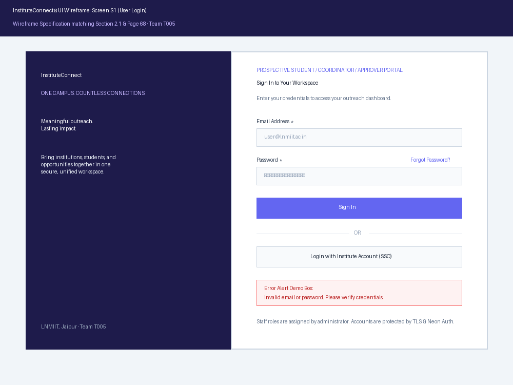
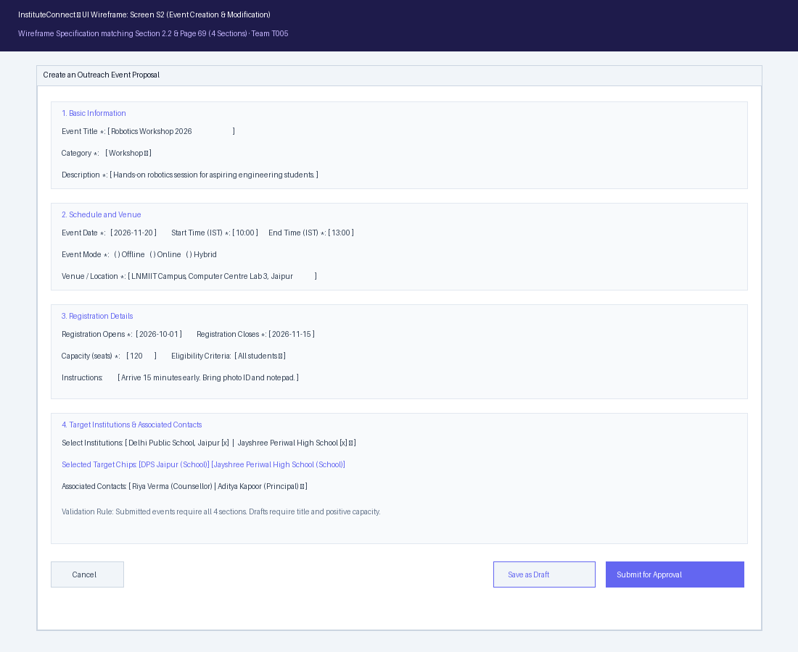
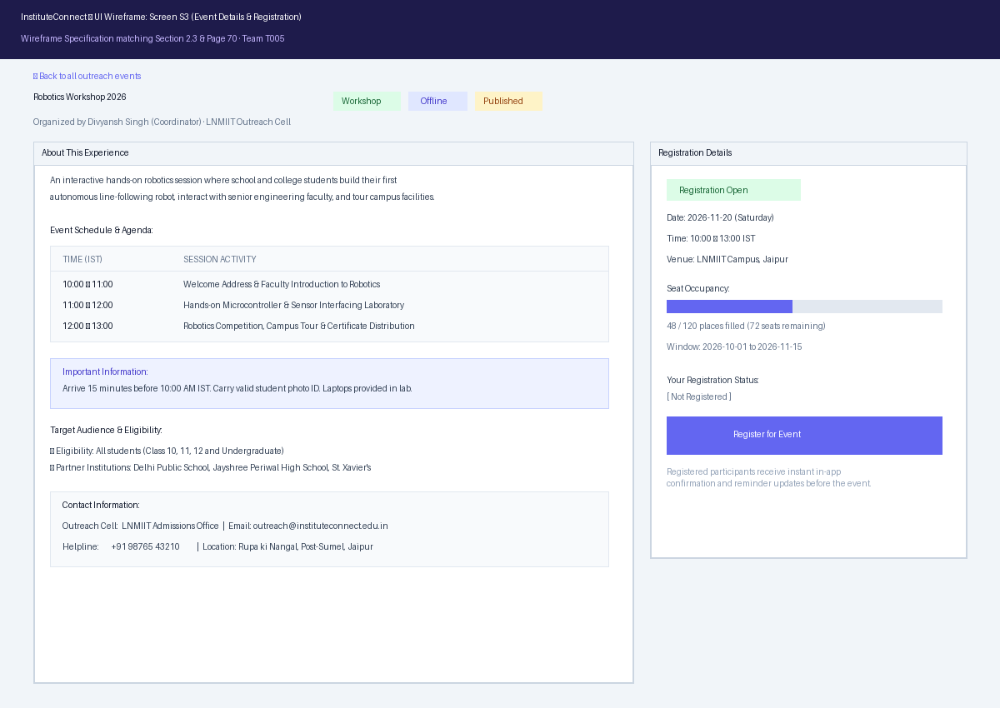
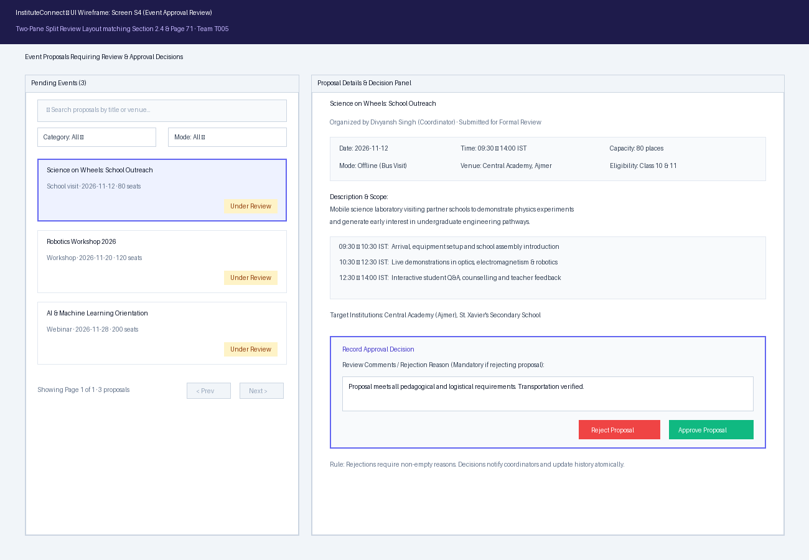

# Interface Design Specification (Assignment 07)
**System:** InstituteConnect – Academic Outreach & Event Collaboration Portal  
**Document Version:** 1.0.0  
**Status:** Approved / Implemented  
**Date:** November 2026  

---

## 1. Introduction & UI Design System

The Interface Design for InstituteConnect provides a seamless, accessible, and responsive user experience for four key user roles: Students, Faculty Coordinators, Institute Administrators / Approvers (Dean / HoD / Director), and External Participants.

### 1.1 Design Principles & Standards
The UI follows the Nielsen Norman Group Usability Heuristics and modern web accessibility guidelines (WCAG 2.1 AA):
- **Visual Hierarchy & Consistency:** Uniform typography, brand colors (LNMIIT Navy `#1E3A8A`, Indigo `#4F46E5`, Emerald `#059669`, Amber `#D97706`, Rose `#E11D48`), consistent spacing, and standardized icon sets.
- **Error Prevention & Immediate Feedback:** Client-side inline form validation prevents submission of invalid states; asynchronous toasts and inline badges communicate background status clearly.
- **Accessibility:** High-contrast color ratios, semantic HTML5 markup, ARIA tags, keyboard navigability (Tab, Enter, Space, Escape), and screen-reader readable tables.
- **Responsive Layout:** Adaptive CSS Grid and Flexbox layouts supporting desktop (1440px+), laptop (1024px–1439px), tablet (768px–1023px), and mobile (<768px).

---

## 2. Screen Specifications & Wireframes

### 2.1 Screen S1: User Authentication & Single Sign-On (SSO)
- **Screen ID:** `UI-SCR-001`
- **Primary Use Case:** UC-001 (User Authentication), UC-002 (SSO Login)
- **Access Level:** Public / Unauthenticated Users
- **Wireframe Reference:** `docs/design/assignment-06/diagrams/interfaces/UI-Wireframe-01.png`



#### 2.1.1 UI Components & Layout
1. **Header Branding:** Institute logo, system title (*InstituteConnect*), and tagline (*Academic Outreach & Event Collaboration Portal*).
2. **Authentication Card:** Centered card with clean elevation shadow containing:
   - **Form Fields:**
     - **Email Address:** Input field (`type="email"`), placeholder `user@institute.ac.in` with real-time format validation.
     - **Password:** Password input field (`type="password"`) with toggleable visibility icon.
   - **Secondary Actions:** "Remember Me" checkbox and "Forgot Password?" recovery link.
   - **Primary Action Button:** "Sign In" button with loading spinner state on submission.
   - **Alternative Authentication:** "OR" divider line followed by "Login with Institute Account" (Google Workspace / Microsoft 365 OAuth SSO) button.
   - **Footer Action:** "Don't have an account? Register Here" redirection link.

#### 2.1.2 Field Validation Rules
| Field Name | Type | Constraints | Error Message |
|:---|:---|:---|:---|
| `email` | String | Valid email RFC 5322 regex; mandatory | "Please enter a valid institute or personal email address." |
| `password` | String | Min 8 chars, 1 uppercase, 1 special character; mandatory | "Password is required and must be at least 8 characters." |

---

### 2.2 Screen S2: Outreach Event Creation & Proposal Submission
- **Screen ID:** `UI-SCR-002`
- **Primary Use Case:** UC-004 (Event Creation & Drafting), UC-005 (Submit for Approval)
- **Access Level:** Faculty Coordinators, Department Event Leads, Administrators
- **Wireframe Reference:** `docs/design/assignment-06/diagrams/interfaces/UI-Wireframe-02.png`



#### 2.2.1 Sectional Architecture
To prevent cognitive overload, the event creation interface is partitioned into four logical visual sections:

##### Section 1: Basic Information
- **Event Title:** Text input, min 5 chars, max 120 chars.
- **Category / Event Type:** Dropdown selector (`Conference`, `Workshop`, `Seminar`, `FDP`, `Webinar`, `Hackathon`, `Outreach Camp`).
- **Event Mode:** Radio buttons (`Offline (In-Person)`, `Online (Virtual)`, `Hybrid`).
- **Event Description:** Multi-line rich textarea describing the objectives, scope, and expected outcomes.

##### Section 2: Schedule & Venue
- **Start Date & End Date:** Date pickers with validation enforcing `End Date >= Start Date >= Today`.
- **Start Time & End Time:** Time pickers enforcing `End Time > Start Time` when dates are identical.
- **Venue / Location:** Physical venue details (e.g., *Auditorium 2, Main Campus*) or virtual platform URL (e.g., *Zoom / Google Meet link*).

##### Section 3: Registration & Capacity Details
- **Participant Capacity:** Integer input with numerical stepper (e.g., 50 to 5000 participants).
- **Registration Open & Close Dates:** Date/time pickers enforcing `Registration Deadline <= Event Start Date`.
- **Registration Fee / Eligibility:** Dropdown / input for fee structures (Free or INR/USD) and eligibility criteria (Open to all, Tier-1/Tier-2 only, Students only).

##### Section 4: Target Institutions & Coordinator Contacts
- **Target Institution Types:** Multi-select pill checkboxes (`Universities`, `Engineering Colleges`, `Polytechnics`, `Schools / Junior Colleges`, `Research Labs`).
- **Primary Coordinator Information:** Full Name, Institute Email, Contact Mobile Number.
- **Action Buttons Bar:**
  - `Save as Draft` (Secondary button – saves event with status `DRAFT`).
  - `Submit for Approval` (Primary button – validates all mandatory fields and promotes to `PENDING_APPROVAL`).
  - `Cancel / Discard` (Tertiary link – warns user of unsaved changes before exiting).

---

### 2.3 Screen S3: Event Details & Participant Registration
- **Screen ID:** `UI-SCR-003`
- **Primary Use Case:** UC-006 (Browse Events), UC-011 (Event Registration), UC-012 (Cancel Registration)
- **Access Level:** All Authenticated Users & External Participants
- **Wireframe Reference:** `docs/design/assignment-06/diagrams/interfaces/UI-Wireframe-03.png`



#### 2.3.1 Component Breakdown
1. **Event Header Banner:**
   - Prominent Event Title with Category Badge (`Workshop`), Mode Badge (`Hybrid`), and Status Tag (`PUBLISHED` / `OPEN FOR REGISTRATION`).
   - Breadcrumb navigation (`Home > Events > National AI Workshop 2026`).
2. **Metadata Summary Grid:**
   - **Date & Time:** Formatted date range and IST timings.
   - **Location:** Physical hall with map link or virtual session link.
   - **Occupancy & Capacity Meter:** Interactive progress bar displaying current filled seats vs total capacity (e.g., *85 / 100 Seats Filled – 15 Seats Remaining!*).
3. **Detailed Agenda & Schedule Table:**
   - Clean tabular display of event itinerary:
     | Time (IST) | Activity / Session | Speaker / Facilitator | Venue |
     |:---|:---|:---|:---|
     | 09:30 AM – 10:00 AM | Inauguration & Keynote Address | Dean Academic Affairs | Main Auditorium |
     | 10:00 AM – 01:00 PM | Hands-on Deep Learning Workshop | Dr. S. Raman | Computing Lab 3 |
     | 01:00 PM – 02:00 PM | Networking Lunch | - | Central Dining Hall |
     | 02:00 PM – 05:00 PM | Capstone Project Showcase & Valedictory | Guest Panel | Lecture Hall 1 |
4. **Important Information & Prerequisites Box:** Callout box highlighting prerequisites, hardware requirements, and certificate eligibility.
5. **Coordinator Contact Card:** Profile avatar, designation, email, and phone contact for attendee inquiries.
6. **Registration Action Pane:**
   - Active state: "Register for this Event" button with instant modal confirmation.
   - Conditional states:
     - Already registered: "Already Registered – [Download Ticket]" + "Cancel Registration" option.
     - Event full: "Event Full – Join Waitlist" badge.
     - Registration deadline passed: "Registration Closed" badge.

---

### 2.4 Screen S4: Event Approval Review (Approver / Administration Portal)
- **Screen ID:** `UI-SCR-004`
- **Primary Use Case:** UC-008 (Review Event Proposal), UC-009 (Approve/Reject Event)
- **Access Level:** HoDs, Dean of Outreach, Director, Administrative Approvers
- **Wireframe Reference:** `docs/design/assignment-06/diagrams/interfaces/UI-Wireframe-04.png`



#### 2.4.1 Two-Pane Split Layout Architecture
The approval interface is built as an interactive master-detail split screen:
1. **Left Pane (Pending Approval Queue - Master List):**
   - **Search & Filter Controls:**
     - Search input searching by title or coordinator name.
     - Category filter dropdown (`All`, `Conferences`, `Workshops`, `Seminars`).
     - Mode filter (`All`, `In-Person`, `Virtual`, `Hybrid`).
   - **Event Proposal Cards:**
     - Card displaying Event Title, Department, Category tag, Proposed Date, and submission date.
     - Visual badge indicating `PENDING_APPROVAL`.
     - Active selection highlight on currently reviewed card.
   - **Pagination Bar:** Page navigation (`Page 1 of 3`) with items per page selector.
2. **Right Pane (Proposal Inspection & Decision Console - Detail View):**
   - **Comprehensive Overview:**
     - Event Title, Organizing Department, and Submitter Profile.
     - Budget Estimate, Expected Headcount, and Target Institutions.
     - Full Description, Prerequisites, and Resource Requirements.
     - Attached Proposal Documents & Brochure previews.
   - **Approver Decision Console:**
     - Decision Review Comments / Justification textarea (`Required for rejection, optional for approval`).
     - **Approval Action Buttons:**
       - `Approve Proposal` (Green Primary Button – transitions status to `APPROVED` / `PUBLISHED` and generates notifications).
       - `Reject Proposal` (Red Danger Button – enforces review remarks and sets status to `REJECTED`).
3. **Bottom Audit Panel (Decision History Table):**
   - Log of historical approval decisions:
     | Event Title | Coordinator | Decision | Decision Date | Approver | Comments |
     |:---|:---|:---|:---|:---|:---|
     | IoT Outreach Hackathon | Dr. A. Sharma | APPROVED | 12 Nov 2026 | Dean Academics | "Approved with sanctioned budget." |
     | Robotics Camp 2026 | Prof. K. Verma | REJECTED | 10 Nov 2026 | HoD CSE | "Schedule clashes with mid-term examinations." |

---

## 3. UI State Transitions & Navigation Flow

```
                      +-------------------+
                      |   Screen S1:      |
                      |   Login / SSO     |
                      +---------+---------+
                                |
               +----------------+----------------+
               | (Authentication Successful)     |
               v                                 v
     [Faculty / Coordinator]           [Dean / Approver]
               |                                 |
               v                                 v
      +-----------------+              +-----------------+
      |   Screen S2:    |              |   Screen S4:    |
      |   Event Create  |              |   Approval Hub  |
      +--------+--------+              +--------+--------+
               |                                |
       (Submit for Review)              (Approve Proposal)
               |                                |
               +----------------+---------------+
                                |
                                v
                      +-------------------+
                      |   Screen S3:      |
                      |   Public Event    |
                      |   Details & Reg   |
                      +-------------------+
```

---

## 4. UI Implementation Mapping
All wireframe specifications are implemented and verified in the active codebase:
- `UI-Wireframe-01`: Verified in `app.mjs` (login form with SSO integration and forgot password modal).
- `UI-Wireframe-02`: Verified in `app.mjs` (4-section event creation form with mode selectors and target institution multi-select).
- `UI-Wireframe-03`: Verified in `app.mjs` (public event detail view with agenda table, occupancy meter, and status badges).
- `UI-Wireframe-04`: Verified in `app.mjs` (two-pane split review console with search, filtering, decision textarea, and audit history table).
